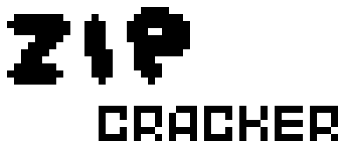
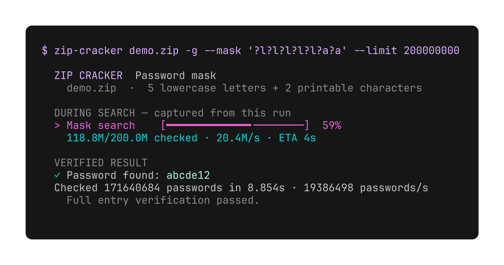
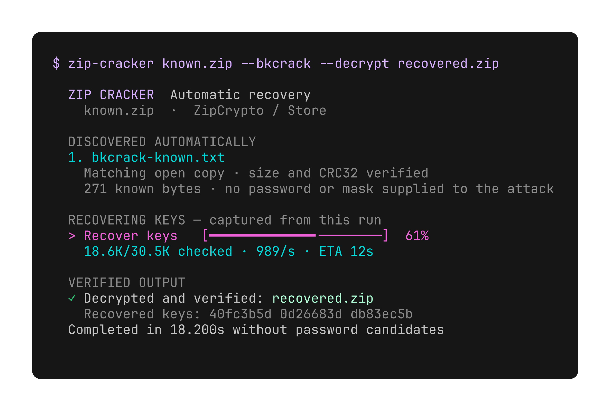

# Overview

[](LICENSE.txt)
[](https://github.com/fresh-milkshake/zip-cracker/releases)
[](https://www.rust-lang.org/)
[](https://github.com/fresh-milkshake/zip-cracker/releases)

Zip Cracker is a ~~powerful~~, modern, and ~~efficient~~ tool for cracking password-protected ZIP files. Utilizing Rust's performance capabilities and parallel computing, this tool provides a fast and convenient solution for recovering lost or forgotten passwords for encrypted ZIP files. The program supports both dictionary-based and brute-force attacks.

## Features

- Multithreaded password cracking for maximum performance
- Dictionary-based attack using custom wordlists
- Bounded parallel generation with adjustable character sets, lengths and masks
- Automatic plaintext assumptions for ZipCrypto recovery through bkcrack

## Installation

### Manual Installation (Recommended)

You can download the precompiled binaries from the [Releases](https://github.com/fresh-milkshake/zip-cracker/releases) page.

### Quick Install

#### Linux/macOS

```bash
curl -sSL https://raw.githubusercontent.com/fresh-milkshake/zip-cracker/master/scripts/install.sh | bash
```

#### Windows (PowerShell)

```powershell
Invoke-WebRequest -Uri "https://raw.githubusercontent.com/fresh-milkshake/zip-cracker/master/scripts/install.ps1" -UseBasicParsing | Invoke-Expression
```

## Usage

### Password generation and masks

```bash
zip-cracker archive.zip -g --min-length 1 --max-length 6
zip-cracker archive.zip -g --mask '?l?l?l?d?d'
zip-cracker archive.zip -g --min-length 7 --max-length 7 --limit 10000000
```

Masks use `?l` for lowercase letters, `?u` for uppercase, `?d` for digits,
`?s` for symbols, `?a` for printable ASCII and `??` for a literal question mark.
Use a mask only when you know the password's structure. `--charset` and `--threads`
configure ordinary generation; `--limit` caps the number of checked candidates.
Defaults are lengths 1–8 and characters `a-zA-Z0-9`. Larger searches can take years.

Live progress and the verified result of one bounded test search:



### Automatic ZipCrypto recovery

```bash
zip-cracker archive.zip --bkcrack --dry-run
zip-cracker archive.zip --bkcrack --decrypt unlocked.zip
```

This mode checks matching open copies beside the archive and inside it, then tries
known structures of PNG, WAV/RIFF, BMP, PDF and JPEG files. The current automatic
templates support ZipCrypto entries stored without ZIP compression. Assumptions
may not match a particular file; successful output is checked before publication.



Install [bkcrack](https://github.com/kimci86/bkcrack) beside the executable, put it
on `PATH`, or pass `--bkcrack-path`. The default time budget is 180 seconds;
`--bkcrack-seconds` changes it. Existing output files are never overwritten.

### Dictionary search

```bash
zip-cracker archive.zip -d words.txt
```

Use one password per line. Progress counts passwords actually checked by workers,
not candidates waiting in the queue.

## Building from Source

To build Zip Cracker from source, follow these steps:

1. Install Rust using [rustup](https://rustup.rs/):

    ```bash
    curl --proto '=https' --tlsv1.2 -sSf https://sh.rustup.rs | sh
    ```

2. Clone the repository:

    ```bash
    git clone https://github.com/fresh-milkshake/zip-cracker
    ```

3. Change to the project directory:

    ```bash
    cd zip-cracker
    ```

4. Build the project:

    ```bash
    cargo build --release
    ```

5. The compiled binary can be found in `target/release/zip-cracker`.

## License

This project is licensed under the [MIT License](LICENSE.txt). Please see the [LICENSE](LICENSE.txt) file for more information.

---

<p align="center">
    <strong>If you like this project, please consider giving it a ⭐️ on GitHub!</strong>
</p>
