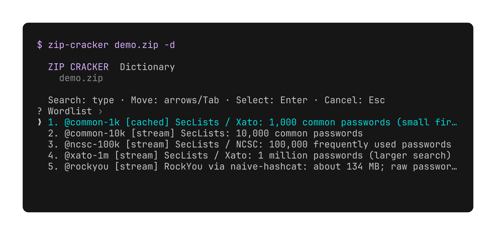

# Overview

[](LICENSE.txt)
[](https://github.com/fresh-milkshake/zip-cracker/releases)
[](https://www.rust-lang.org/)
[](https://github.com/fresh-milkshake/zip-cracker/releases)

Zip Cracker is a ~~powerful~~, modern, and ~~efficient~~ tool for cracking password-protected ZIP files. Utilizing Rust's performance capabilities and parallel computing, this tool provides a fast and convenient solution for recovering lost or forgotten passwords for encrypted ZIP files. The program supports both dictionary-based and brute-force attacks.

## Features

- Supports `.zip` (including ZIP64), `.zipx` and ZIP-based self-extracting `.exe` (SFX) archives
- Parallel password search with dictionaries, character sets and masks
- Searchable wordlist library, offline copies and direct HTTP/gzip streaming
- Automatic key recovery for ZipCrypto + Store through bkcrack
- Live progress, search limits and verified results

## Installation

### Manual Installation (Recommended)

You can download the precompiled binaries from the [Releases](https://github.com/fresh-milkshake/zip-cracker/releases) page.

### Quick Install

#### Linux/macOS

```bash
curl -sSL https://raw.githubusercontent.com/fresh-milkshake/zip-cracker/master/scripts/install.sh | bash
```

#### Windows (PowerShell)

```powershell
Invoke-WebRequest -Uri "https://raw.githubusercontent.com/fresh-milkshake/zip-cracker/master/scripts/install.ps1" -UseBasicParsing | Invoke-Expression
```

## Usage

### Password generation and masks

Use `-g` to generate candidates from a character set or a known password pattern.

```bash
zip-cracker archive.zip -g --min-length 4 --max-length 6 --charset '0123456789'
zip-cracker archive.zip -g --mask 'backup-?d?d?d?d'
zip-cracker archive.zip -g --min-length 7 --max-length 7 --limit 10000000
```

Without a mask, defaults are lengths **1–8** and characters `a-zA-Z0-9`.
`--min-length`, `--max-length` and `--charset` narrow the search; lengths up to
16 and unique ASCII charset characters are supported.

Masks combine literal text with `?l` lowercase, `?u` uppercase, `?d` digits,
`?s` symbols/spaces, `?a` printable ASCII and `??` a literal question mark.
The example above tries `backup-0000` through `backup-9999`. Quote masks in your
shell; `--mask` cannot be combined with length or charset options.

`--threads N` sets workers for either search. `--limit N` caps the total checked
candidates, including searches spanning several lengths. Progress shows checked
counts and speed; matches are verified against decrypted data. Narrow the search
where possible: unknown-password searches can still take years.


### Automatic ZipCrypto recovery

Use `--bkcrack` to recover encryption keys from known or inferred file bytes and
produce an unlocked ZIP. This automatic mode supports **ZipCrypto + Store**
(entries without ZIP compression).

```bash
zip-cracker archive.zip --bkcrack --dry-run
zip-cracker archive.zip --bkcrack --decrypt unlocked.zip
zip-cracker archive.zip --bkcrack --bkcrack-seconds 300 --threads 6
```

The program looks for matching open copies beside or inside the archive, then
tries PNG, WAV/RIFF, BMP, PDF and JPEG structures. Format guesses can fail;
`--dry-run` previews the available assumptions without starting recovery or
requiring the backend.

Install [bkcrack](https://github.com/kimci86/bkcrack) beside the executable, on
`PATH`, or select it with `--bkcrack-path PATH`. `--bkcrack-seconds` controls the
total time budget (default **180 s**); `--attempt-seconds` limits each format
variant (default **60 s**). `--threads N` sets backend workers.

Output defaults to `NAME.unlocked.zip` beside the input; `--decrypt PATH`
changes it. The complete decrypted archive is verified before publication,
and existing output files are never overwritten.


### Dictionary search — `-d`

```bash
zip-cracker archive.zip -d                                                  # Interactive selection
zip-cracker archive.zip -d words.txt                                        # Local text or .gz file
zip-cracker archive.zip -d '@common-10k' -d personal.txt                    # Multiple sources
zip-cracker archive.zip -d 'https://example.com/list.txt' --limit 100000
```

Without a source, `-d` opens a searchable menu: type to filter, arrows/Tab to
navigate, Enter to select, Esc to cancel. It works in any shell with an
interactive terminal. For scripts, pass a file, URL or quoted `'@ID'`.



Available dictionaries: `common-1k`, `common-10k`, `ncsc-100k`, `xato-1m`
([SecLists](https://github.com/danielmiessler/SecLists)) and
`rockyou` ([RockYou mirror](https://github.com/brannondorsey/naive-hashcat/releases/tag/data)).

```bash
zip-cracker wordlists list                                  # Browse the library
zip-cracker wordlists fetch common-10k                      # Save an offline copy
zip-cracker wordlists fetch common-10k --refresh            # Update it
zip-cracker wordlists import personal.txt --name personal
zip-cracker wordlists remove personal                       # Keeps the original file
```

- **Files and gzip:** one password per line, read with bounded memory. Spaces and
  original bytes are preserved; UTF-8 BOM and CRLF are handled.
- **URLs and uncached IDs:** searched directly over HTTP, without saving the
  whole file or imposing a dictionary-size cap. Verified saved copies are reused.
  Sources run in order and stop after a verified match or the candidate limit.
- **Offline:** `--offline` uses only local/saved copies. `--wordlist-dir PATH`
  changes the library location. Explicit `wordlists fetch` downloads are limited
  to 2 GiB; direct HTTP search has no such limit. Interrupted streams cannot
  automatically resume.

See `--help` and `wordlists --help` for all options.

## Building from Source

To build Zip Cracker from source, follow these steps:

1. Install Rust using [rustup](https://rustup.rs/):

   ```bash
   curl --proto '=https' --tlsv1.2 -sSf https://sh.rustup.rs | sh
   ```

2. Clone the repository:

   ```bash
   git clone https://github.com/fresh-milkshake/zip-cracker
   ```

3. Change to the project directory:

   ```bash
   cd zip-cracker
   ```

4. Build the project:

   ```bash
   cargo build --release
   ```

5. The compiled binary can be found in `/target/release/`.

## License

This project is licensed under the [MIT License](LICENSE.txt). Please see the [LICENSE](LICENSE.txt) file for more information.

---

<p align="center">
    <strong>If you like this project, please consider giving it a ⭐️ on GitHub!</strong>
</p>
